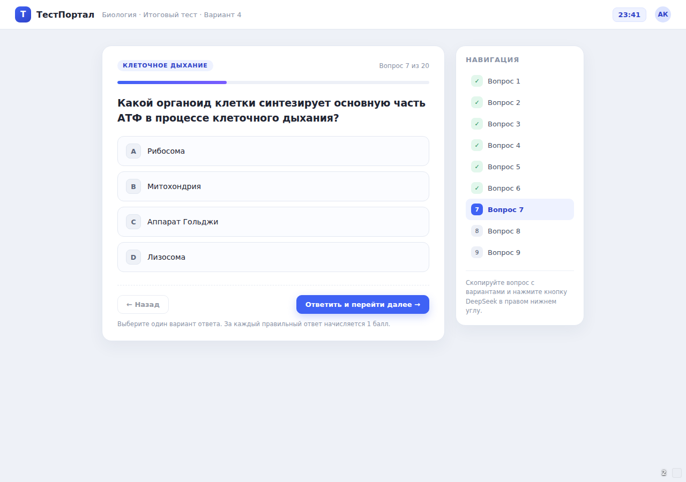
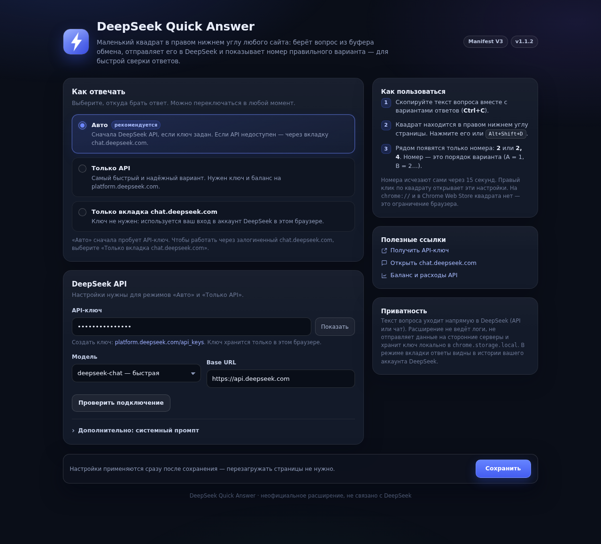

# DeepSeek Quick Answer

Помощник для сверки ответов в тестах и викторинах. Скопируйте вопрос с вариантами ответов,
нажмите маленький квадрат в правом нижнем углу страницы — расширение отправит вопрос в DeepSeek
и покажет номер правильного варианта. Удобно, когда нужно быстро проверить свой ответ или
понять, где ошибка.

**Репозиторий:** <https://github.com/dRammir/quick-answer> · готовая сборка лежит в
[`dist/deepseek-quick-answer-1.1.2.zip`](dist/deepseek-quick-answer-1.1.2.zip).



## Зачем это

- Сверить свой ответ после решения теста.
- Разобрать ошибку, когда ответ не сходится.
- Быстро пройтись по вопросам при подготовке.

Расширение не ведёт полноценный диалог и не показывает объяснений — только номер варианта,
чтобы ответ читался за секунду.

## Что умеет

- Квадрат **18×18 px** в правом нижнем углу, с отступом 8 px. Он занимает минимум места, не мешает содержимому
  страницы, а при наведении подсвечивается.
- По клику читает вопрос с вариантами ответов из буфера обмена.
- Отправляет вопрос в DeepSeek и показывает **только номер правильного варианта**: `2` для
  одного вопроса, `2, 4` — для нескольких.
- Номера считаются по порядку: первый вариант = 1, второй = 2 и так далее. Если варианты
  подписаны буквами, `A = 1`, `B = 2`, `C = 3`…
- Если в буфере несколько вопросов, номера идут в том же порядке, что и вопросы.
- Цифры исчезают через 15 секунд, чтобы не мешать странице. Чтобы увидеть ответ снова,
  нажмите квадрат ещё раз (вопрос должен остаться в буфере).
- Если модель не смогла выделить номер, вместо него появится `?`; если произошла ошибка — `!`.
  Причина видна во всплывающей подсказке при наведении на квадрат.
- Правый клик по квадрату открывает настройки. Настройки также доступны на
  `chrome://extensions` → «Подробнее» → «Параметры расширения».
- Горячая клавиша `Alt+Shift+D` делает то же самое, что и клик.

Если не можете найти квадрат — он в самом правом нижнем углу; при наведении подсвечивается.

## Установка

1. Скачайте репозиторий: `git clone https://github.com/dRammir/quick-answer.git`
   (или на GitHub нажмите **Code → Download ZIP** и распакуйте). Готовая сборка уже лежит в
   `dist/deepseek-quick-answer-1.1.2.zip` — её тоже достаточно распаковать в отдельную папку.
2. Откройте `chrome://extensions`.
3. Включите **Режим разработчика** (справа сверху).
4. Нажмите **Загрузить распакованное расширение** и выберите папку проекта
   (ту, где лежит `manifest.json`).
5. Откроется страница настроек. Выберите способ работы:
   - **API** — вставьте ключ с [platform.deepseek.com/api_keys](https://platform.deepseek.com/api_keys),
     нажмите «Проверить подключение», затем «Сохранить»;
   - **Вкладка chat.deepseek.com** — войдите в [chat.deepseek.com](https://chat.deepseek.com)
     в этом браузере; ключ не нужен.
6. Откройте сайт с тестом. Если квадрата нет — обновите страницу: расширение подключается
   к уже открытым вкладкам только после перезагрузки.

> Расширение не опубликовано в Chrome Web Store — это локальная сборка, устанавливаемая
> в режиме разработчика.

При установке Chrome предупредит, что расширение может **читать данные, которые вы копируете**:
это разрешение нужно, чтобы забирать вопрос из буфера обмена. Без него расширение не сможет
прочитать вопрос.

## Как пользоваться

1. Выделите вопрос вместе с вариантами и скопируйте (`Ctrl+C`).
2. Нажмите маленький квадрат в правом нижнем углу или `Alt+Shift+D`.
3. Через 1–5 секунд рядом появится номер правильного варианта. Если вопросов несколько —
   несколько номеров через запятую.
4. Сверьте номер с выбранным вариантом. Цифры исчезнут сами через 15 секунд; при необходимости
   нажмите квадрат ещё раз.

### Режимы

| Режим | Что делает |
| --- | --- |
| **Авто** | Если ключ задан — сначала API, при ошибке пробует вкладку `chat.deepseek.com`. Если ключа нет — сразу вкладка. |
| **Только API** | Только `api.deepseek.com`. Нужен ключ и баланс. |
| **Только вкладка** | Только `chat.deepseek.com` под вашим аккаунтом. Ключ не нужен. |

> В режиме «Авто» при наличии API-ключа запросы идут в API, а вкладка `chat.deepseek.com`
> используется только как запасной вариант. Чтобы работать именно через залогиненный чат,
> выберите **«Только вкладка chat.deepseek.com»**.

В веб-режиме расширение ищет открытую вкладку `chat.deepseek.com`, при необходимости открывает
новую и вставляет вопрос в поле ввода. Если вкладки не было, она временно открывается активной,
а после ответа фокус возвращается на исходную страницу. **Не закрывайте вкладку чата во время
запроса.** Вопросы и ответы остаются в истории вашего чата DeepSeek.

## Настройки

| Параметр | Зачем |
| --- | --- |
| Режим | Авто / API / вкладка. |
| API-ключ | Хранится только локально (`chrome.storage.local`). |
| Модель | `deepseek-chat` — быстрая; `deepseek-reasoner` — точнее на сложных вопросах, но медленнее. |
| Base URL | По умолчанию `https://api.deepseek.com`. Можно указать прокси; Chrome запросит доступ к домену. |
| Системный промпт | Инструкция модели. По умолчанию она возвращает только `ОТВЕТ: <номер>`; менять осторожно. |



## Приватность

- Текст вопроса отправляется напрямую в DeepSeek: либо в API, либо в ваш чат на `chat.deepseek.com`.
- API-ключ хранится в локальном хранилище браузера и никуда, кроме `api.deepseek.com`
  (или указанного вами Base URL), не уходит.
- Расширение не собирает статистику, не пишет логи и не использует сторонние серверы.
- В веб-режиме запросы видны в истории вашего аккаунта DeepSeek.

## Ограничения

- Показываются **только номера**, без текста варианта и без объяснения. Если нужен текст ответа,
  используйте DeepSeek напрямую.
- Квадрат не появляется на `chrome://…`, в Chrome Web Store и на служебных страницах браузера —
  Chrome не разрешает туда контент-скрипты.
- Расширение рассчитано на текст. Картинки, сканы и PDF-вопросы нужно распознать в текст заранее.
- Если модель ошибётся в нумерации (например, посчитает варианты не с первого), номер будет
  неверным — это ограничение любой модели.
- Веб-режим зависит от вёрстки `chat.deepseek.com`: если DeepSeek её заметно изменит, режим может
  потребовать обновления расширения. Для стабильной работы используйте API.
- В инкогнито расширение нужно отдельно разрешить (`chrome://extensions` → «Подробнее» →
  «Разрешить в режиме инкогнито»).
- Цифры исчезают через 15 секунд и не копируются — это компактный режим для быстрой сверки,
  а не полноценный чат.

## Если что-то не работает

| Симптом | Что делать |
| --- | --- |
| Не вижу квадрат | Он в самом правом нижнем углу (8 px от края), маленький. Наведите курсор — подсветится. |
| Номера исчезли | Цифры живут 15 секунд. Нажмите квадрат ещё раз, пока вопрос в буфере. |
| Появился `?` | Модель не вернула номер. Наведите на квадрат — в подсказке будет её ответ. Проверьте ключ/режим и повторите. |
| Появился `!` | Ошибка. Наведите на квадрат — покажется причина: 401, 402, лимит, сеть или вход в чат. |
| Веб-режим не используется или сразу ошибка | Убедитесь, что выбран режим **«Только вкладка chat.deepseek.com»**: в «Авто» при наличии ключа запросы идут в API. |
| «Неверный API-ключ» (401) | Пересоздайте ключ на platform.deepseek.com и сохраните заново. |
| «Недостаточно средств» (402) | Пополните баланс API или переключитесь на режим вкладки. |
| Веб-режим: нужен вход / не нашёл поле ввода | Откройте `chat.deepseek.com`, войдите в аккаунт, обновите вкладку и повторите. |
| Правый клик не открывает настройки | Откройте `chrome://extensions` → «Подробнее» → «Параметры расширения». |

После изменения кода расширения нажмите «Обновить» на `chrome://extensions` и перезагрузите
страницы, где уже открыта старая версия.

## Разработка

```
manifest.json          манифест MV3
background.js          service worker: API, веб-вкладка, буфер, маршрутизация сообщений
content.js             квадрат с номерами на сайтах + мост chat.deepseek.com
offscreen.html/.js     чтение буфера обмена через offscreen-документ
options.html/.js       страница настроек
lib/core.js            промпт, нормализация настроек, извлечение номеров вариантов
icons/                 PNG-иконки (генерируются)
test/                  юнит-тесты, E2E и тестовая страница-опросник
tools/                 генератор иконок, статическая проверка, сборка zip
```

Команды:

```bash
npm install          # puppeteer для E2E (скачает Chrome for Testing)
npm run icons        # перегенерировать иконки
npm test             # юнит-тесты парсинга/настроек/номеров
npm run validate     # манифест, ссылки, CSP, синтаксис
npm run test:e2e     # реальный Chrome: квадрат, буфер, API (заглушка), веб-режим
npm run package      # собрать dist/deepseek-quick-answer-<версия>.zip
```

E2E не обращается к настоящему DeepSeek: `fetch` в service worker подменяется заглушкой,
а `chat.deepseek.com` — локальной мок-страницей, поэтому тест бесплатный и работает офлайн.
Он проверяет, что квадрат компактный и не перекрывает страницу, что ответов может быть
несколько, что буква `B` превращается в `2`, что номера исчезают и что ошибки не рисуют
лишних окон. Скриншоты теста складываются в `preview/`.

Если Chrome не запускается в минимальном Linux-контейнере из-за отсутствующих `libnss3`,
`libnspr4` или `libasound2`, положите распакованные библиотеки в `.cache/libs` — E2E подхватит
их через `LD_LIBRARY_PATH`. В обычном десктопном Chrome это не нужно.

Стоимость запросов в режиме API — по тарифам DeepSeek; режим вкладки использует ваш обычный
аккаунт DeepSeek.

CI на GitHub проверяет юнит-тесты и статическую валидацию на каждый push; E2E требует локального
Chrome и запускается вручную через `npm run test:e2e`.

## Лицензия и статус

Неофициальный проект, не связан с DeepSeek. Предназначен для самопроверки и сверки ответов;
используйте с учётом правил вашей учебной платформы.
